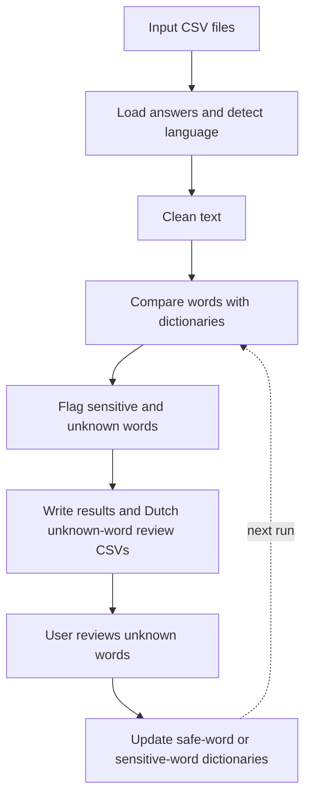

# SEAA: Semi-automatic Anonymization Algorithm

SEAA detects and anonymizes potentially privacy-sensitive words in open-ended survey responses. It is designed primarily for Dutch text; responses in other languages are detected but not translated.

> **Important:** SEAA can miss sensitive information. Review all results manually; it does not replace human review.

## Overview

SEAA reads semicolon-separated CSV files, detects the language of each answer, then compares words with safe-word and privacy-term dictionaries. It flags known sensitive terms and words not in the safe-word list, replaces them with category markers in a censored-answer column, and writes analysis and Dutch unknown-word review files. Users can update the dictionaries between runs based on their review.

## Flowchart



## Prerequisites

- Python 3.15.2 or later
- Git, to clone the repository
- pip, included with Python, to install dependencies

## Installation

```bash
git clone https://github.com/uashogeschoolutrecht/SEAA.git
cd SEAA
python -m pip install -r requirements.txt
```

Run commands from the repository root; SEAA loads its dictionaries from the `dict/` folder.

## Usage

Process every CSV file in an input folder:

```bash
python cli.py <input_folder> <output_folder>
```

Options:

```bash
python cli.py ./data ./output --file input.csv
python cli.py ./data ./output --limit 1000
```

`--file` selects one file within the input folder; `--limit` processes only the first N responses in each selected file. Omit both to process all CSV files and rows.

SEAA can also be called from Python:

```python
from main import process_answers

results_df, avg_words_df = process_answers("./data", "./output")
```

## Input CSV

Input files must be semicolon-separated and contain an `Answer` column. UTF-8 files with or without a BOM are supported. Other columns, such as `respondent_id` and `question_id`, are preserved in the main output but are not required.

```csv
respondent_id;Answer;question_id
1001;Mijn docent Peter heeft mij enorm geholpen;Q1
1002;Ik had moeite met concentratie tijdens de lessen;Q1
```

## Output

Two semicolon-separated files are written to the output folder, with the current date in `YYYYMMDD` format:

- `SEAA_output_<date>.csv` — original input columns plus cleaned text, detected language, privacy flag, unknown and flagged words, and censored answer.
- `avg_words_count_<date>.csv` — Dutch unknown words not already flagged, with their frequency (`AVG_woord`, `Count`). Review these words and update dictionaries as appropriate.

Flagged words are replaced with category markers such as `[NAME]`; other unknown words are marked `[UNKNOWN]`.

## Dictionaries

SEAA loads safe words from `wordlist.txt` and `whitelist.txt`. It flags terms from `illness.txt`, `studiebeperking.txt`, `names.txt`, `blacklist.txt`, `plaatsnamen.txt`, `familie.txt`, and `persoonlijke_omstandigheden.txt`, all in `dict/`.

`dict/wordlist.txt` is based on [OpenTaal's Dutch wordlist](https://github.com/OpenTaal/opentaal-wordlist), version 2.20.23 (2023-03-10). The file has a `words` header and its `NA` entry was removed; OpenTaal's license is retained in `dict/LICENSE-opentaal.txt`.

Add reviewed safe words to `whitelist.txt` and sensitive words to `blacklist.txt` to improve future results.

## Limitations

SEAA uses dictionary matching and may miss context-dependent or unlisted sensitive information. It is intended primarily for Dutch; other languages are not translated, and the unknown-word review list is generated only for Dutch responses.

## License

SEAA's original code is licensed under the MIT License; see [LICENSE](LICENSE). Third-party resources, including the OpenTaal wordlist, remain subject to their own licenses.
